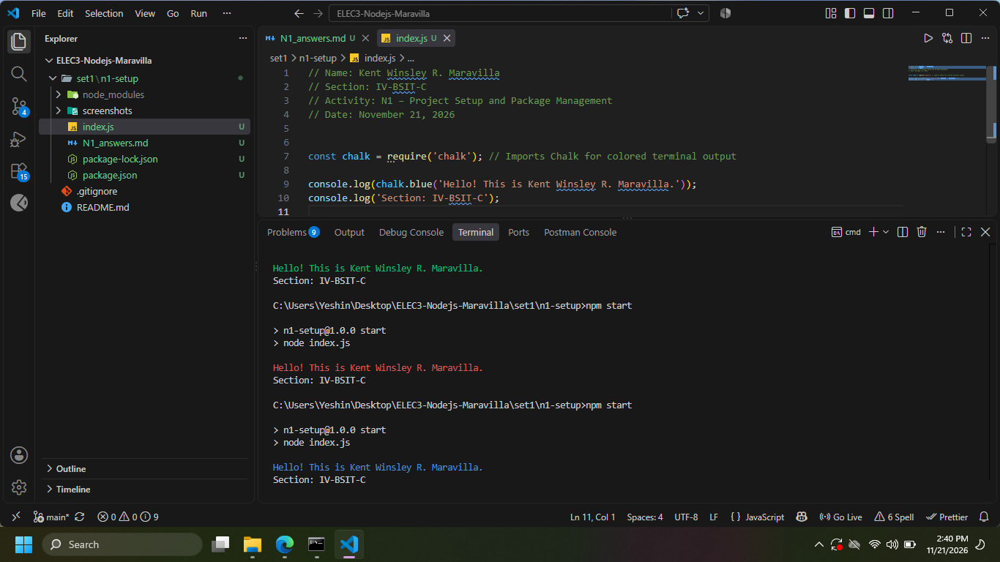
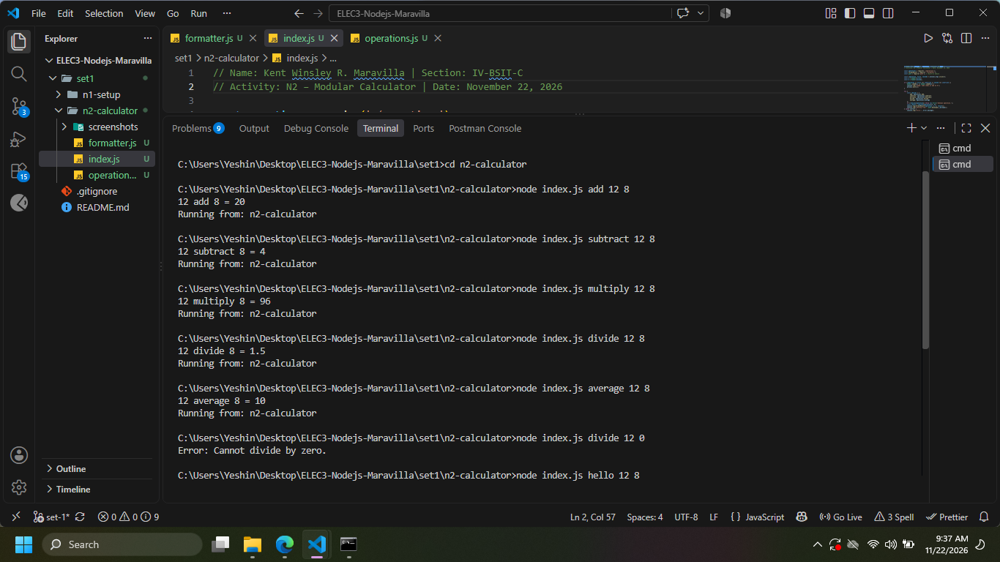
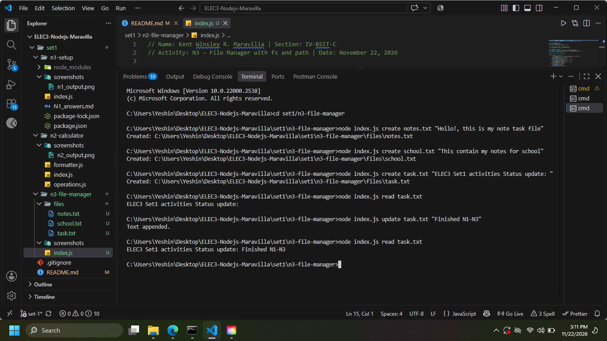
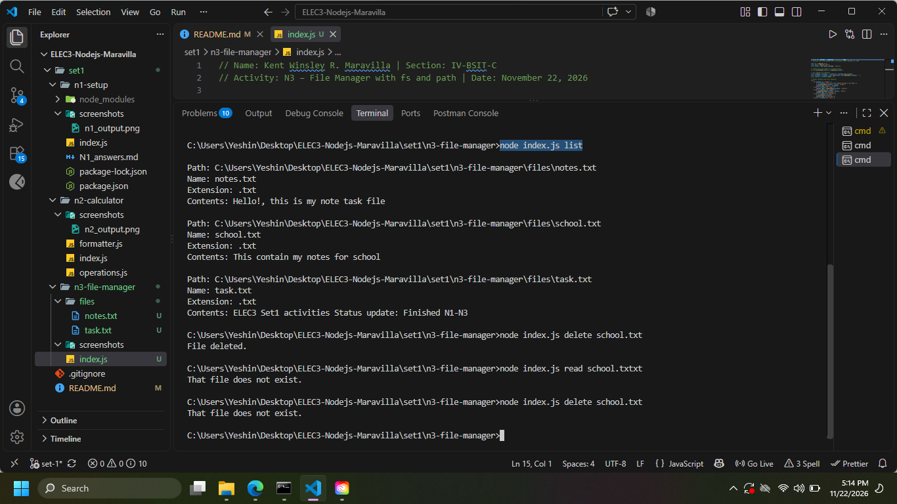

# ELEC3-Nodejs-Maravilla

**ELEC 3 - Node.js Activities**

- **Name:** Kent Winsley R. Maravilla
- **Section:** IV-BSIT-C
- **Course:** ELEC 3 - Node.js

## Set 1 - Node.js Activities

| Activity | Description | Run |
|---|---|---|
| N1 | npm and package.json | `npm start` |
| N2 | Modular Calculator | `node set1/n2-calculator/index.js add 12 8` |
| N3 | File Manager | `node set1/n3-file-manager/index.js list` |

## Set 1 Screenshots

### N1 - npm and package.json

### N2 - Modular Calculator

### N3 - File Manager

---

This README will be updated as more activities are completed.

